<picture>
  <source media="(max-width: 600px) and (prefers-color-scheme: dark)" srcset="assets/hero-compact-dark.svg">
  <source media="(max-width: 600px)" srcset="assets/hero-compact-light.svg">
  <source media="(prefers-color-scheme: dark)" srcset="assets/hero-dark.svg">
  
</picture>

I'm a data scientist and ML engineer in Manchester. I build models that businesses can price, plan and make decisions with. I test them on data they haven't seen, explain every prediction, and ship them as services other teams can call.

**What I build:** Pricing and risk models (dynamic pricing, property valuation, customer churn), served behind typed APIs, containerised and deployed.

**Now:** Research Data Scientist at Rebel Hive (sole data scientist on a client NLP tool) and AI Data Specialist (RLHF & SFT) at Mercor, reviewing model outputs for frontier training. 

**Background:** MSc Data Science with Distinction, University of Salford (2026) · BEng Electronic Engineering, First Class equivalent. 

**Looking for:** Data science or ML engineering roles in the UK.

## Featured systems

  <a href="https://github.com/michizler/alloy-tower-data-platform"><picture><source media="(prefers-color-scheme: dark)" srcset="assets/cards/alloytower-dark.svg">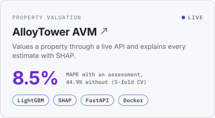</picture></a>
  <picture><source media="(prefers-color-scheme: dark)" srcset="assets/cards/rebelhive-dark.svg">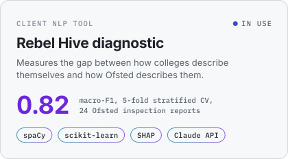</picture>
  <a href="https://github.com/michizler/data-science-projects/tree/master/llm-feedback-analyzer"><picture><source media="(prefers-color-scheme: dark)" srcset="assets/cards/llm-feedback-dark.svg">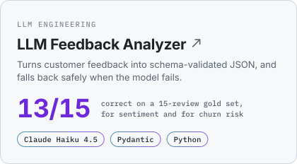</picture></a>
  <a href="https://github.com/michizler/voyage-rails-analytics"><picture><source media="(prefers-color-scheme: dark)" srcset="assets/cards/voyagerail-dark.svg">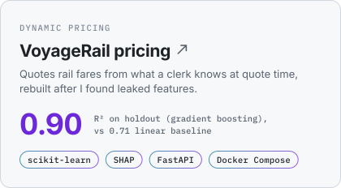</picture></a>

  Try AlloyTower live: <a href="https://alloy-avm.streamlit.app/">app</a> · <a href="https://alloytower-avm-api.onrender.com/docs">API docs</a>. The free-tier API can take about 40 seconds to wake. 
  Rebel Hive is client work, so its code is private.

## How I build

- **Evaluate before you trust.** A hand-labelled gold set for the [LLM analyzer](https://github.com/michizler/data-science-projects/tree/master/llm-feedback-analyzer), 5-fold CV for [AlloyTower](https://github.com/michizler/alloy-tower-data-platform), and Ljung-Box residual tests that ruled out two of three [US Bancorp](https://github.com/michizler/usb-stock-timeseries-model) models.
- **Explain every prediction.** Each [AlloyTower](https://github.com/michizler/alloy-tower-data-platform) valuation comes back with the SHAP contributions behind it.
- **Document the limitations.** AlloyTower's [data-quality report](https://github.com/michizler/alloy-tower-data-platform/blob/master/project_brief/AlloyTower_Data_Quality_Findings.pdf) ranks 11 findings by severity, including coordinates that turned out to be random.
- **Ship it.** A [live app](https://alloy-avm.streamlit.app/) and [API](https://alloytower-avm-api.onrender.com/docs) that redeploy on every push, and services that start with one Docker Compose command.

<b>How AlloyTower fits together</b>

 

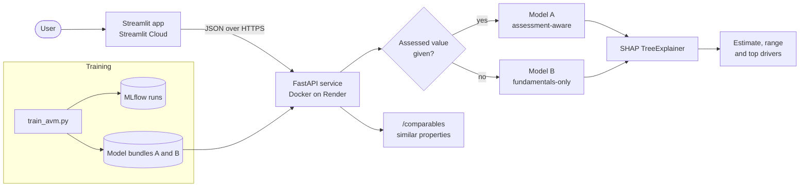

## Toolkit

<picture><source media="(max-width: 600px) and (prefers-color-scheme: dark)" srcset="assets/toolkit/languages-compact-dark.svg"><source media="(max-width: 600px)" srcset="assets/toolkit/languages-compact-light.svg"><source media="(prefers-color-scheme: dark)" srcset="assets/toolkit/languages-dark.svg"></picture>
<picture><source media="(max-width: 600px) and (prefers-color-scheme: dark)" srcset="assets/toolkit/software-compact-dark.svg"><source media="(max-width: 600px)" srcset="assets/toolkit/software-compact-light.svg"><source media="(prefers-color-scheme: dark)" srcset="assets/toolkit/software-dark.svg">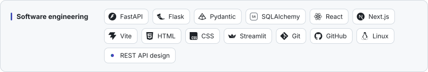</picture>
<picture><source media="(max-width: 600px) and (prefers-color-scheme: dark)" srcset="assets/toolkit/datascience-compact-dark.svg"><source media="(max-width: 600px)" srcset="assets/toolkit/datascience-compact-light.svg"><source media="(prefers-color-scheme: dark)" srcset="assets/toolkit/datascience-dark.svg">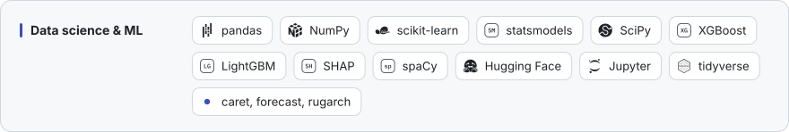</picture>
<picture><source media="(max-width: 600px) and (prefers-color-scheme: dark)" srcset="assets/toolkit/llm-compact-dark.svg"><source media="(max-width: 600px)" srcset="assets/toolkit/llm-compact-light.svg"><source media="(prefers-color-scheme: dark)" srcset="assets/toolkit/llm-dark.svg">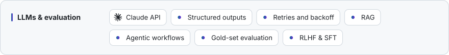</picture>
<picture><source media="(max-width: 600px) and (prefers-color-scheme: dark)" srcset="assets/toolkit/dataeng-compact-dark.svg"><source media="(max-width: 600px)" srcset="assets/toolkit/dataeng-compact-light.svg"><source media="(prefers-color-scheme: dark)" srcset="assets/toolkit/dataeng-dark.svg">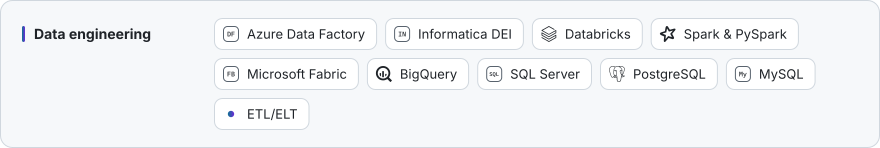</picture>
<picture><source media="(max-width: 600px) and (prefers-color-scheme: dark)" srcset="assets/toolkit/mlops-compact-dark.svg"><source media="(max-width: 600px)" srcset="assets/toolkit/mlops-compact-light.svg"><source media="(prefers-color-scheme: dark)" srcset="assets/toolkit/mlops-dark.svg">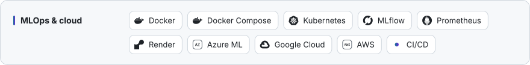</picture>
<picture><source media="(max-width: 600px) and (prefers-color-scheme: dark)" srcset="assets/toolkit/bi-compact-dark.svg"><source media="(max-width: 600px)" srcset="assets/toolkit/bi-compact-light.svg"><source media="(prefers-color-scheme: dark)" srcset="assets/toolkit/bi-dark.svg">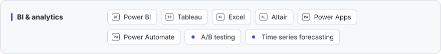</picture>

## More work

<a href="https://github.com/michizler/usb-stock-timeseries-model"><picture><source media="(max-width: 600px) and (prefers-color-scheme: dark)" srcset="assets/work/usb-compact-dark.svg"><source media="(max-width: 600px)" srcset="assets/work/usb-compact-light.svg"><source media="(prefers-color-scheme: dark)" srcset="assets/work/usb-dark.svg">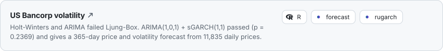</picture></a>
<a href="https://github.com/michizler/strataforge-prediction"><picture><source media="(max-width: 600px) and (prefers-color-scheme: dark)" srcset="assets/work/strataforge-compact-dark.svg"><source media="(max-width: 600px)" srcset="assets/work/strataforge-compact-light.svg"><source media="(prefers-color-scheme: dark)" srcset="assets/work/strataforge-dark.svg">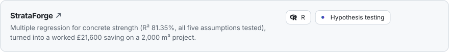</picture></a>
<a href="https://github.com/michizler/reder-analytics"><picture><source media="(max-width: 600px) and (prefers-color-scheme: dark)" srcset="assets/work/reder-compact-dark.svg"><source media="(max-width: 600px)" srcset="assets/work/reder-compact-light.svg"><source media="(prefers-color-scheme: dark)" srcset="assets/work/reder-dark.svg">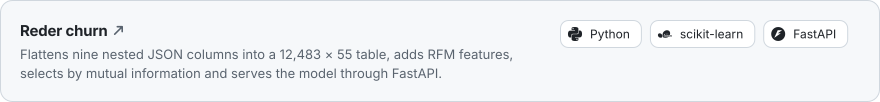</picture></a>
<a href="https://github.com/michizler/data-science-projects/tree/master/databricks-bigdata-analytics"><picture><source media="(max-width: 600px) and (prefers-color-scheme: dark)" srcset="assets/work/databricks-compact-dark.svg"><source media="(max-width: 600px)" srcset="assets/work/databricks-compact-light.svg"><source media="(prefers-color-scheme: dark)" srcset="assets/work/databricks-dark.svg">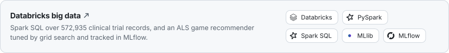</picture></a>
<a href="https://github.com/michizler/sql-database-projects"><picture><source media="(max-width: 600px) and (prefers-color-scheme: dark)" srcset="assets/work/sql-compact-dark.svg"><source media="(max-width: 600px)" srcset="assets/work/sql-compact-light.svg"><source media="(prefers-color-scheme: dark)" srcset="assets/work/sql-dark.svg">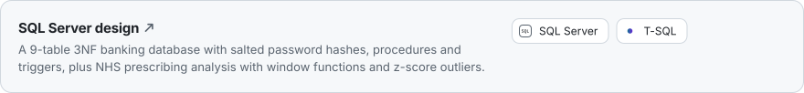</picture></a>
<a href="https://github.com/michizler/imf-globaleconomy-analytics"><picture><source media="(max-width: 600px) and (prefers-color-scheme: dark)" srcset="assets/work/imf-compact-dark.svg"><source media="(max-width: 600px)" srcset="assets/work/imf-compact-light.svg"><source media="(prefers-color-scheme: dark)" srcset="assets/work/imf-dark.svg">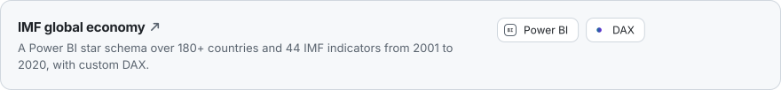</picture></a>

Every metric on this page comes from the linked repo, except Rebel Hive, which is private client work.

 

  <a href="mailto:michizler@gmail.com"><picture><source media="(prefers-color-scheme: dark)" srcset="assets/footer/email-dark.svg"></picture></a>
  <a href="https://www.linkedin.com/in/bright-uzosike"><picture><source media="(prefers-color-scheme: dark)" srcset="assets/footer/linkedin-dark.svg"></picture></a>
  <a href="https://github.com/michizler/data-science-projects"><picture><source media="(prefers-color-scheme: dark)" srcset="assets/footer/portfolio-dark.svg"></picture></a>

